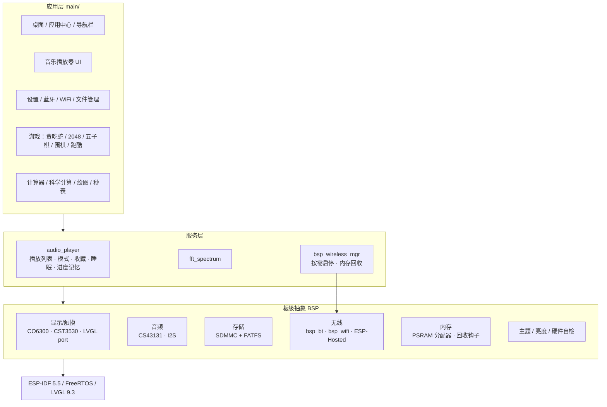

# P4-IDF_CO6300-MIPI_ESP-LVGL-PORT_V9

基于 **ESP32-P4 + LVGL 9** 的竖屏智能播放器固件 —— 262×928 AMOLED 长条屏、表盘式桌面、完整的音乐播放链路、蓝牙耳机输出、以及在设备上直接可玩的 5 个小游戏。

整套 UI 与业务逻辑全部由 C/C++ 在片上手写实现，不依赖任何云端服务：解码、渲染、AI 对弈、内存管理都在本地完成。

---

## 目录

- [项目简介](#项目简介)
- [功能总览](#功能总览)
- [功能详解](#功能详解)
- [硬件平台](#硬件平台)
- [软件架构](#软件架构)
- [技术亮点](#技术亮点)
- [目录结构](#目录结构)
- [编译与烧录](#编译与烧录)
- [SD 卡目录约定](#sd-卡目录约定)
- [操作与手势](#操作与手势)
- [已知限制](#已知限制)
- [开源协议](#开源协议)

---

## 项目简介

ESP32-P4 本身没有 WiFi / 蓝牙硬件，本项目通过 **ESP-Hosted over SDIO** 挂一颗 ESP32 协处理器来补齐无线能力，主机侧则把 P4 的算力全部用在显示与音频上：

- **显示**：CO6300 AMOLED，262×928 竖屏，MIPI DSI 单 lane 360 Mbps，RGB565，双 framebuffer + DMA2D
- **音频**：CS43131 DAC + I2S，44.1 kHz / 16 bit / 立体声，同时支持蓝牙 A2DP 与本地 I2S 双路输出
- **交互**：CST3530 电容触摸，仿手机的三键导航 + 手势操作
- **存储**：TF 卡（SDMMC 4-bit）存放音乐、歌词、贴图与配置

目标形态是一台「能放进口袋的音乐播放器 / 腕机」：桌面即表盘，下拉是控制中心，上滑进应用中心，播放器里能看歌词和频谱，设置里能跑硬件自检和 PSRAM 测速。

---

## 功能总览

| 分类 | 能力 |
| --- | --- |
| 桌面系统 | 表盘（时间/日期/星期）、顶部状态栏、下拉控制中心、应用中心、三键导航、最近任务、边缘侧滑返回 |
| 音乐播放 | WAV / MP3 解码、ID3 标题与歌手、LRC 歌词同步、24 段实时频谱、黑胶唱片动画、播放列表、进度拖动、音量、4 种播放模式、收藏夹、睡眠定时、断点记忆播放 |
| 音频输出 | 本地 I2S（CS43131）+ 蓝牙 A2DP 双路同时输出、软件音量增益、淡入与静音预填充消爆音 |
| 蓝牙 | 经典蓝牙 + BLE 4.2 扫描、SSP 配对、A2DP Source、已配对设备持久化、开机自动回连、断线退避重连 |
| WiFi | STA 扫描、密码输入（可显隐）、连接、已保存网络管理（SD 卡持久化） |
| 文件管理 | 浏览 SD 卡 FAT 文件系统、目录进出、文件大小、点击音频直接播放、中文文件名 GBK 兜底解码 |
| 设置 | 蓝牙 / WiFi / 亮度 / 音量 / 硬件测试 / 后台内存管理 / 主题配色 / 关于设备 |
| 实用工具 | 计算器、科学计算器、函数绘图、秒表 |
| 游戏 | 贪吃蛇、2048、五子棋（三档 AI）、围棋 9×9（三档 AI）、竖版跑酷（PNG 贴图 + 视差滚动） |
| 系统能力 | PSRAM 优先分配器、LVGL 自定义内存、内存回收钩子、按需启停无线协议栈、硬件自检、6 套主题持久化 |

---

## 功能详解

### 1. 桌面与系统 UI

- **表盘桌面**：渐变背景 + 44px 大号时间 + 「2026年7月22日 星期三」式中文日期，状态栏显示 WiFi / 蓝牙 / 时间 / 电池图标。
- **下拉控制中心**：从屏幕顶部下滑，带动画滑出半透明面板，含 2×2 快捷开关（WiFi、蓝牙、静音、设置）+ 亮度滑块 + 音量滑块，上滑收起。
- **应用中心**：桌面左滑或底部上滑进入，12 个应用卡片以 2 列网格排布，卡片颜色跟随主题。
- **三键导航栏**：常驻 `layer_top` 浮层的返回 / 主页 / 最近任务三键，内部维护屏幕栈；最近任务以卡片形式展示已打开的页面。
- **侧滑返回**：屏幕左缘 40px 区域内右滑触发返回，和 iOS 手势一致。
- **统一 UI 框架**：`ui_navbar`（导航栈）、`ui_dialog`（统一弹窗）、`ui_anim`（过渡动画）、`ui_page`（页面骨架）为所有子页面复用。

### 2. 音乐播放器

三个页签，覆盖「听」的完整链路：

**播放页**
- 纯 LVGL 对象绘制的黑胶唱片（无 Canvas / 无大缓冲，播放时旋转 + 高光摆动）
- 歌名循环滚动、歌手名超长省略
- 进度条可拖动 seek，左右显示当前 / 总时长
- 上一曲 / 播放暂停 / 下一曲
- 工具行：播放模式（顺序 / 随机 / 单曲 / 循环）、收藏、睡眠定时（15 / 30 / 45 / 60 分钟）、播放列表弹窗

**歌词页**
- 解析同名 `.lrc`，按时间轴逐行高亮并自动滚动居中
- 切歌时在后台任务里读 SD + 解析，命中缓存直接复用，不阻塞 UI

**频谱页**
- 播放任务把 PCM 喂给 FFT 模块，24 段条形按 30~60 ms 刷新，颜色沿色相渐变

**底层能力**
- `micro_mp3`（OpenCore 系 MP3 解码）+ 自写 WAV 解析，单声道自动上混为立体声
- ID3v2 标签读取标题 / 歌手，无标签回退文件名
- 播放列表后台扫描 `/sdcard/music`，扫描完通过回调把名称表推到 UI，开机不等扫描
- 断点记忆：索引 + 秒数 + 播放模式存 NVS（命名空间 `player`），并兼容迁移旧版 `playback.cfg`
- 收藏夹持久化到 `/sdcard/favorites.cfg`

### 3. 蓝牙（A2DP Source）

- 通过 ESP-Hosted 使用协处理器的 **经典蓝牙 + BLE 4.2**（ESP32 硬件上限，不支持 BLE 5.0）
- 经典蓝牙设备发现 + BLE 扫描双通道，结果标注 `[音频]` / `[经典]` / `[BLE]`，并按 Class of Device 识别耳机 / 音箱
- 手机风格的「配对并连接」确认弹窗，配对成功后写入 NVS `bt_paired`
- 开机自动回连上次设备，被其它设备抢走后按 1s / 3s / 7s / 15s / 30s 退避重连
- 音频路径：解码后的 PCM 同时写入 I2S 与 A2DP ring（256 KB PSRAM），SBC 编码在核 0 独立进行
- 消爆音处理：静音预填充 + 约 20 ms 线性淡入
- 与 WiFi 共存：A2DP 播放时自动收起 WiFi 的 SDIO 流量，避免 `eh_sdio: invalid ret` 死锁

### 4. WiFi

- STA 扫描（最多 20 个 AP，显示 SSID / 信号 / 加密方式 / 是否已保存）
- 密码输入键盘，支持明文 / 密文切换，无密码可留空直连
- 已保存网络写入 `/sdcard/wifi.cfg`，可查看与删除

> 说明：WiFi 界面与驱动代码已完整实现，实际可用性取决于 ESP-Hosted 的 WiFi 特性是否在 menuconfig 中启用（`CONFIG_ESP_HOSTED_HOST_FEAT_WIFI`）。当前 sdkconfig 里该选项未开启，UI 会明确提示「未配置 ESP-Hosted WiFi」。

### 5. 文件管理器

- 浏览 `/sdcard` 的 FAT 文件系统，显示目录 / 文件图标与大小
- 点击目录进入，返回键回上级
- 点击 `.wav` / `.mp3` 直接交给播放器播放
- 中文文件名做了两级处理：FATFS 以 UTF-8 返回优先，非法 UTF-8 时用内嵌的 **GB2312/GBK → Unicode 表**（6763 汉字 + 符号区）兜底转换，解决乱码

### 6. 设置中心

| 项目 | 内容 |
| --- | --- |
| 蓝牙耳机 | 开关、扫描、配对、已配对列表、取消配对 |
| WiFi 连接 | 开关、扫描、连接、已保存网络 |
| 亮度调节 | 0–255 滑块 + 预览区，MIPI DCS `0x51` 直控，NVS 持久化，500 ms 防抖写盘 |
| 音量调节 | 0–100 滑块 + 静音键，I2S 走 CS43131 硬件音量，BT 走软件增益 |
| 硬件测试 | 一键自检 I2C 总线、CS43131、SD 卡、ESP-Hosted 从机，逐项显示通过/失败与详情 |
| 后台管理 | PSRAM / 内部 RAM / LVGL 堆的用量与碎片度、1 MB PSRAM 读写测速、手动触发内存回收 |
| 主题颜色 | 6 套主题（深蓝 / 暗夜 / 森林 / 紫罗兰 / 日落 / 海洋），选中即全局换色并存 SD |
| 关于设备 | 芯片、屏幕、DAC、触摸型号、固件版本、构建时间、SD 状态、曲库数量 |

### 7. 实用工具

- **计算器**：四则运算，带表达式显示
- **科学计算器**：三角函数、对数、幂、开方、π 等，31 字符表达式缓冲
- **函数绘图**：输入表达式，`lv_chart` 绘制 80 点曲线，X 轴范围可调
- **秒表**：开始 / 暂停 / 复位，毫秒级计时

### 8. 游戏

| 游戏 | 玩法与实现 |
| --- | --- |
| 贪吃蛇 | 12×24 网格，四方向滑动转向，随机食物，随长度加速 |
| 2048 | 4×4 棋盘，四方向滑动合并，分数与最高分；局内进度与最高分都持久化到 SD 卡，重进可续局 |
| 五子棋 | 15×21 棋盘，人机 / 双人切换、悔棋，三档难度，AI 为 minimax + α-β 剪枝（简单深度 1、困难深度 2、超级深度 4 + 着法排序） |
| 围棋 | 9×9，完整气 / 提子 / 劫 / 禁着 / 双虚手终局，中国规则数子、白贴 7 目；AI 三档（随机+提子 / 2 层 / 3 层 + 战术检查） |
| 跑酷 | 竖版三跑道，触屏左右切道、中上区域跳跃；**绕过 LVGL 控件**用 dummy draw 直接接管 MIPI 屏幕裸渲染，40–50 FPS，三张 262×928 背景视差滚动，PNG 贴图从 SD 解码进 PSRAM |

游戏页面全部**懒加载**：启动时只创建入口，点击后才构建对象，避免开机阶段堆出大量 LVGL 对象。

---

## 硬件平台

| 部件 | 型号 / 规格 | 接口与引脚 |
| --- | --- | --- |
| 主控 | ESP32-P4（双核 RISC-V） | — |
| 显示屏 | CO6300 AMOLED 262×928 | MIPI DSI 1 lane @360 Mbps，DPI 14 MHz（约 45 Hz），RST=GPIO23，VCI_EN=GPIO53 |
| 触摸 | CST3530 | I2C0 @400 kHz，SDA=18 / SCL=19 / INT=22 / RST=21 |
| 音频 DAC | CS43131 | I2S0：BCK=16 / WS=17 / DO=54；I2C 地址 0x30，RST=GPIO20 |
| 存储 | TF 卡 | SDMMC Slot 0，4-bit：D0=39 / D1=40 / D2=41 / D3=42 / CLK=43 / CMD=44，挂载点 `/sdcard` |
| 无线协处理器 | ESP32（经典 BT + BLE 4.2 + WiFi） | ESP-Hosted SDIO：CMD=28 / CLK=31 / D0=27 / D1=26 / D2=30 / D3=29 / RST=32 |
| 麦克风 | PDM MIC | SCK=3 / DATA=4（引脚已预留） |
| Flash | 16 MB QIO | 分区：`factory` 8 MB + `storage` 7 MB |

显示电源由片上 LDO 通道 3 提供 2500 mV 给 MIPI PHY；SD 卡使用 LDO 通道 4。

---

## 软件架构



**任务与核分配**

| 任务 | 所在核 | 说明 |
| --- | --- | --- |
| LVGL 渲染任务 | Core 1 | `task_affinity = 1`，避免被核 0 的 SBC 编码抢占 |
| Bluedroid（BTC/BTU） | Core 0 | SBC 编码高频运行，与 LVGL 隔离 |
| ESP-Hosted SDIO | Core 0 | 无线数据搬运 |
| 音频解码 / 播放 | 独立任务 | 逐块解码后写 I2S + A2DP ring |
| 音乐扫描 / 歌词加载 | 临时任务（栈可放 PSRAM） | 不阻塞 UI |

**跨线程约定**：任何非 LVGL 任务访问 LVGL 都必须经过 `ui_lvgl_async_call()`（内部持 `lvgl_port_lock`），否则会与 LVGL 定时器链表并发写冲突导致界面冻结。

---

## 技术亮点

1. **PSRAM 优先的内存体系**
   `bsp_memory` 提供 `bsp_memory_malloc/calloc/realloc/aligned_alloc` 与 C++ `PSRAMAllocator`，优先 PSRAM、失败回退内部 RAM，保留内部 RAM 给 DMA 与中断；周期性监控用量、碎片度与大块水位。

2. **LVGL 自定义分配器**
   `lv_mem_psram.c` 把 LVGL 全部内存（对象 / 样式 / 缓存）搬到 PSRAM，移除原来的 128 KB 内部静态池，并通过链接期 `-u` 预置符号确保被拉入最终镜像。

3. **按需启停的无线子系统**
   开机不做任何无线初始化。UI 打开蓝牙 / WiFi 开关时由 worker 线程异步拉起 SDIO 链路与协议栈，关闭时完整反初始化回收内存；内部 RAM 低于 40 KB 低水位时，回收钩子自动停掉「已开启但未连接」的协议栈。

4. **内存回收钩子机制**
   `bsp_memory_register_reclaim()` 支持多优先级回调，常规 / 紧急两档 urgency，配合 60 s 冷却，避免协议栈反复启停。

5. **双核分工解决音画互卡**
   LVGL 钉核 1、Bluedroid 钉核 0，是「播放时拖动进度条卡顿」这类问题的根因级修法。

6. **无线带宽仲裁**
   A2DP 播放时把 WiFi 降到最低流量甚至关闭，把 SDIO 全部让给 BT HCI；断开后恢复。这是 P4 + ESP-Hosted 同时跑 WiFi + BT 的必备处理。

7. **消爆音链路**
   A2DP 启动前用静音预填充 ring（约 700 ms 缓冲），媒体流开始后再做 20 ms 线性淡入，消除起播 pop 与 underflow。

8. **中文显示与中文文件名**
   内嵌 20 px CJK 点阵字体（1bpp，覆盖 0x4E00–0x9FFF），FATFS 侧开启 UTF-8 API 编码，非法 UTF-8 再走自建 GB2312→Unicode 表兜底。

9. **裸渲染跑酷**
   通过 `esp_lvgl_adapter` 的 dummy draw 模式在「LVGL 接管」与「游戏独占屏幕」之间切换，绕开控件系统的开销，直接向 framebuffer 刷帧。

10. **可观测性**
    设置页内置硬件自检、内存看板、PSRAM 实测带宽；串口日志按 `UI_INIT_DESKTOP_BEGIN/DONE` 这类阶段标记输出，便于定位启动崩溃点。

---

## 目录结构

```
P4-IDF_CO6300-MIPI_ESP-LVGL-PORT_V9/
├── main/                       # 应用主体
│   ├── main.c                  # 启动流程：LCD → 触摸 → LVGL → SD → 音频 → UI → 无线
│   ├── bsp_*.c/h               # 板级驱动：显示、触摸、音频、SD、亮度、主题、内存、无线管理、自检
│   ├── audio_player.c          # 播放器核心（列表 / 模式 / 收藏 / 睡眠 / 进度 / 双路输出）
│   ├── audio_decoder.c         # WAV / MP3 解码封装
│   ├── id3_tags.c              # ID3v2 标签解析
│   ├── lrc_parser.c            # LRC 歌词解析
│   ├── fft_spectrum.c          # 24 段频谱
│   ├── ui_desktop.c            # 表盘 + 状态栏 + 控制中心
│   ├── ui_music_player.c       # 播放 / 歌词 / 频谱三页签
│   ├── ui_settings.c           # 设置主页与 8 个子页
│   ├── ui_bluetooth.c          # 蓝牙扫描 / 配对 / 已配对管理
│   ├── ui_wifi.c               # WiFi 扫描 / 密码键盘 / 已保存网络
│   ├── ui_file_manager.c       # SD 卡文件浏览
│   ├── ui_apps.c               # 应用中心网格
│   ├── ui_navbar.c             # 三键导航 + 最近任务
│   ├── ui_dialog.c / ui_anim.c / ui_page.c / ui_gesture.c
│   ├── game_*.c / *_game.cpp   # 贪吃蛇 / 2048 / 五子棋 / 围棋 / 跑酷
│   ├── ui_calculator.c / ui_scientific_calculator.c / ui_function_plotter.c / ui_stopwatch.c
│   ├── esp_2_41ttf.c           # 内嵌 20px 中文字体
│   ├── gbk_to_unicode.c        # GBK → Unicode 转换表
│   ├── lv_mem_psram.c          # LVGL 自定义 PSRAM 分配器
│   └── ui_lvgl_async.c         # 线程安全的 LVGL 异步投递
├── components/
│   ├── esp_lcd_co6300/         # CO6300 AMOLED 面板驱动（MIPI / SPI 双实现）
│   ├── esp_lcd_touch_cst3530/  # CST3530 触摸驱动
│   ├── esp_hosted_hci_bluedroid/ # 把 Hosted HCI 接到 Bluedroid
│   └── micro_mp3/              # MP3 解码器
├── esp32_coprocessor/          # ESP32 协处理器固件（BT controller，需单独烧录）
├── tietu/paoku/                # 跑酷贴图（player / obstacle / collect / bg）
├── tools/                      # GBK 码表生成与嵌入脚本
├── partitions.csv              # 8 MB app + 7 MB storage
├── sdkconfig.defaults          # PSRAM / LVGL / ESP-Hosted / Bluedroid 关键配置
└── download_assets.ps1         # 一键下载 CC0 平台跳跃素材并生成跑酷贴图
```

---

## 编译与烧录

### 环境要求

| 项 | 版本 |
| --- | --- |
| ESP-IDF | v5.5.x（工程在 v5.5.4 上构建） |
| 目标芯片 | esp32p4 |
| LVGL | 9.3.x（随组件管理器拉取） |
| Flash | 16 MB，QIO |

### 主机固件

```bash
idf.py set-target esp32p4
idf.py build
idf.py -p <PORT> flash monitor
```

首次构建会自动拉取 `esp_lvgl_port`、`esp_lvgl_adapter`、`esp_hosted`、`esp_wifi_remote`、`esp_audio_codec`、`lvgl` 等托管组件到 `managed_components/`（约 300 MB），因此该目录与 `build/` 都不入库。

### 协处理器固件（蓝牙）

ESP32-P4 没有蓝牙硬件，必须先给协处理器烧录 HCI 固件，否则蓝牙相关功能不可用：

```bash
cd esp32_coprocessor
idf.py set-target esp32
idf.py build
idf.py -p <CP_PORT> flash monitor
```

详细步骤（SDIO 引脚、HCI 超时排查）见 [`esp32_coprocessor/README.md`](esp32_coprocessor/README.md)。

### 游戏贴图（可选）

跑酷游戏需要 `/sdcard/tietu/paoku/` 下的 PNG 贴图。仓库内已带一份 `tietu/paoku/`，如需重新生成：

```powershell
powershell -NoProfile -ExecutionPolicy Bypass -File download_assets.ps1
```

脚本会下载 Kenney「New Platformer Pack」（CC0）并自动裁切成三张 262×928 视差背景与角色 / 障碍 / 金币精灵，然后把 `tietu/paoku/` 整体拷到 SD 卡根目录。

---

## SD 卡目录约定

```
/sdcard/
├── music/                # 音乐库（.wav / .mp3），同名 .lrc 自动关联歌词
├── tietu/paoku/          # 跑酷贴图：player/ obstacle/ collect/ bg/
├── brightness.cfg        # 亮度（旧版兼容，主存储已迁移到 NVS）
├── volume.cfg            # 音量
├── theme.cfg             # 主题
├── favorites.cfg         # 收藏夹
├── wifi.cfg              # 已保存的 WiFi
├── game_2048.dat         # 2048 局内进度
├── game_2048_best.dat    # 2048 最高分
└── playback.cfg          # 旧版播放进度（仅用于一次性迁移）
```

建议 FAT32 / exFAT 格式化，音乐与图片文件名支持中文。

---

## 操作与手势

| 操作 | 效果 |
| --- | --- |
| 桌面顶部下滑 | 打开控制中心 |
| 桌面左滑 / 底部上滑 | 进入应用中心 |
| 屏幕左缘右滑 | 返回上一级 |
| 控制中心上滑 | 收起面板 |
| 导航栏「返回 / 主页 / 最近」 | 返回栈顶上一屏 / 回桌面 / 查看最近应用 |
| 播放页点击黑胶 | 播放 / 暂停 |
| 拖动进度条 | 跳转播放位置 |
| 跑酷：点左/右半屏 | 切道；点中上区域跳跃 |

---

## 已知限制

- **WiFi**：需要开启 `CONFIG_ESP_HOSTED_HOST_FEAT_WIFI` 才能真正使用；当前 sdkconfig 未开启，UI 会提示未配置。
- **蓝牙版本**：协处理器为 ESP32，仅支持 BLE 4.2，不支持 BLE 5.0。
- **音频格式**：仅 WAV / MP3，暂无 FLAC / AAC；暂无内嵌封面（APIC）解析。
- **电池图标**：状态栏电池为静态占位，尚未接入 ADC 电量采样。
- **麦克风**：PDM 引脚已定义，录音功能尚未实现。
- **AI 对弈**：围棋「超级」难度与五子棋最高难度在设备端计算，思考时间会明显变长。

---

## 调试记录

仓库内保留了两份排障笔记，记录了 P4 + ESP-Hosted + LVGL 组合下的典型问题：

- [`debug-ui-startup-crash.md`](debug-ui-startup-crash.md)：启动阶段 `Store access fault` 的定位过程（最终改为游戏页懒加载）
- [`debug-esp-hosted-sdio-watchdog.md`](debug-esp-hosted-sdio-watchdog.md)：SDIO 看门狗与无线链路稳定性

---

## 致谢

- [LVGL](https://lvgl.io/) 9.3 —— UI 框架
- [ESP-IDF](https://github.com/espressif/esp-idf) 与 [ESP-Hosted](https://github.com/espressif/esp-hosted) —— 底层与无线桥接
- [micro_mp3](https://github.com/espressif/esp-adf-libs) / OpenCore MP3 解码
- [Kenney New Platformer Pack](https://opengameart.org/content/new-platformer-pack)（CC0）—— 跑酷贴图

---

## 开源协议

本项目以 **Apache License 2.0** 开源，全文见 [LICENSE](LICENSE)；第三方组件与素材的归属声明见 [NOTICE](NOTICE)。

| 依赖 | 许可证 |
| --- | --- |
| LVGL 9.3 | MIT |
| lodepng | zlib |
| micro_mp3 / OpenCore MP3 解码 | Apache-2.0 |
| ESP-IDF、ESP-Hosted、esp_lvgl_port、esp_lvgl_adapter 等乐鑫组件 | Apache-2.0 |
| esp_lcd_co6300、esp_lcd_touch_cst3530 | Apache-2.0 |
| Kenney 贴图（跑酷 / 游戏图标 / 农场） | CC0 1.0 |

> 说明：`main/esp_2.41ttf.c` 是由 TTF 转换得到的中文点阵字体，仓库内未附带源字体的授权信息。若用于商业分发，建议先确认源字体许可，或改用 OFL 授权的思源黑体重新生成。
